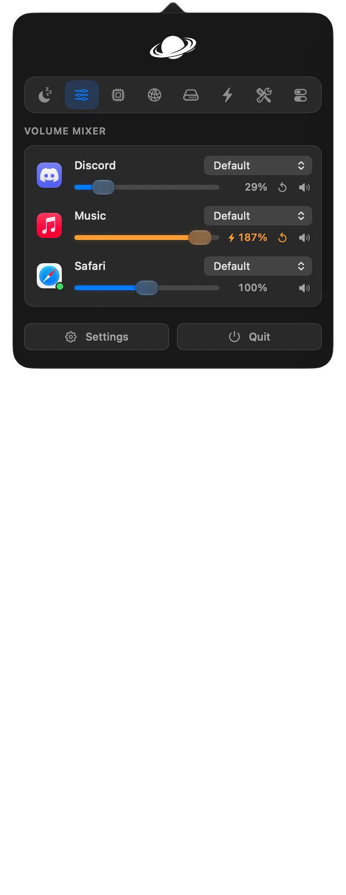
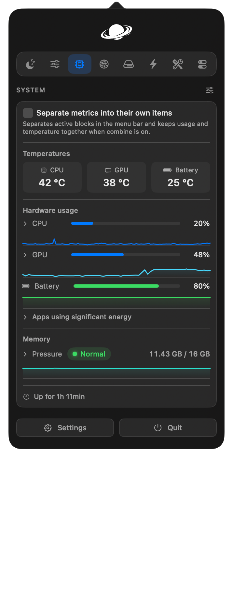
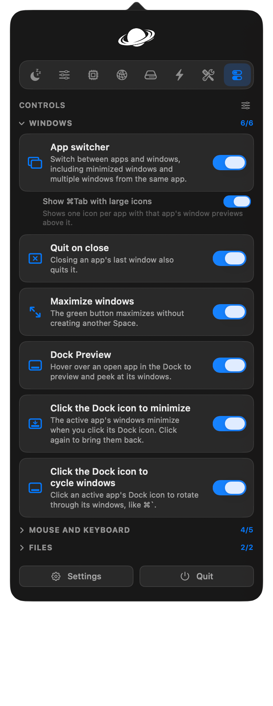
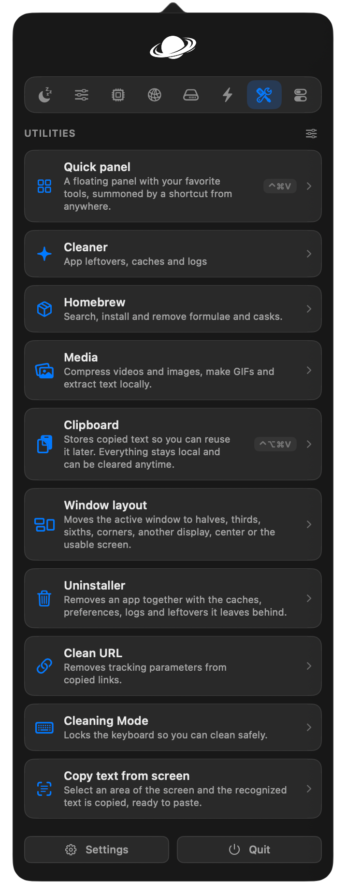
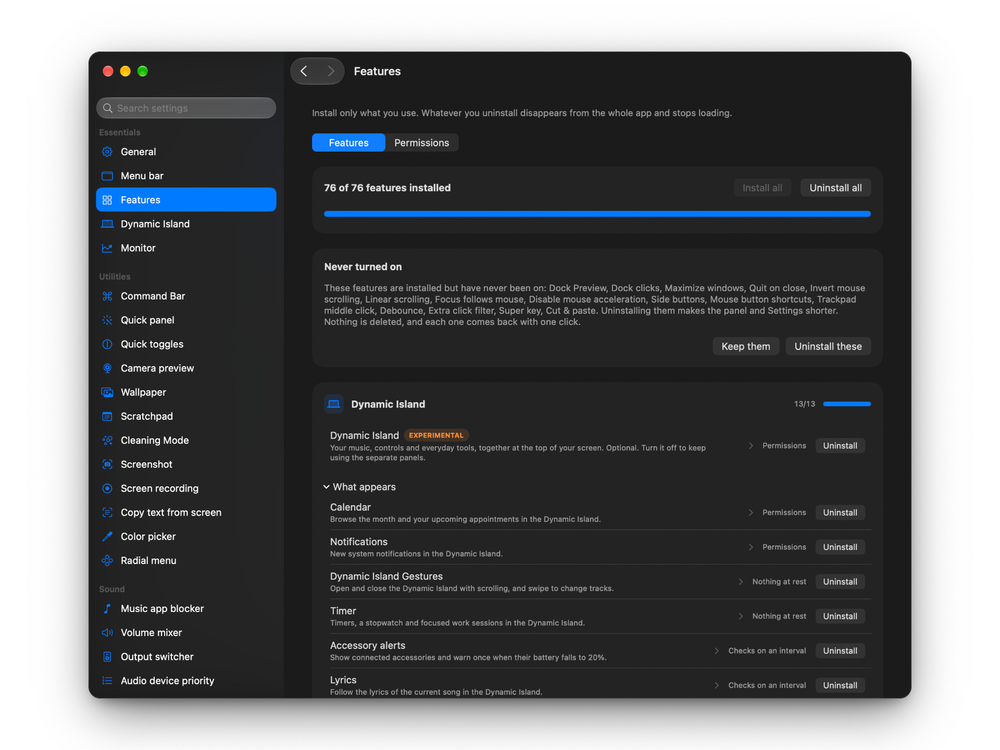
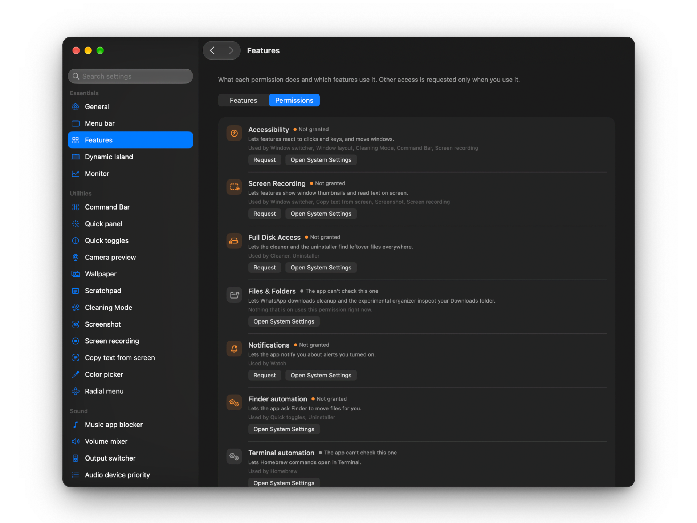

<p align="center">
  <picture>
    <source media="(prefers-color-scheme: dark)" srcset="docs/assets/readme/logo-dark.svg">
    
  </picture>
</p>

<h1 align="center">Vorssaint</h1>

<p align="center">
  One menu bar icon doing the job of a dozen paid Mac apps.<br>
  Install only what you use.
</p>

<p align="center">
  <a href="https://vorssaint.com">Website</a> ·
  <a href="#install">Install</a> ·
  <a href="#everything-it-does">Features</a> ·
  <a href="#private-by-default">Privacy</a> ·
  <a href="CHANGELOG.md">Changelog</a> ·
  <a href="mailto:hello@vorssaint.com">Contact</a> ·
  <a href="https://discord.gg/M6BwWH4BJp">Discord</a>
</p>

<p align="center">
  <a href="https://github.com/vorssaint/vorssaint-utils/releases"></a>
  <a href="https://github.com/vorssaint/vorssaint-utils/releases"></a>
  <a href="https://github.com/vorssaint/vorssaint-utils/actions/workflows/ci.yml"></a>
  <a href="#what-you-need"></a>
  <a href="LICENSE"></a>
</p>

<p align="center">
  <a href="https://buymeacoffee.com/vorssaint">
    
  </a>
</p>

<p align="center">
  For anything private, email
  <a href="mailto:hello@vorssaint.com"><strong>hello@vorssaint.com</strong></a>.
</p>

<p align="center">
  <a href="https://trendshift.io/repositories/53716?utm_source=repository-badge&amp;utm_medium=badge&amp;utm_campaign=badge-repository-53716" target="_blank" rel="noopener noreferrer"></a>
  <a href="https://trendshift.io/repositories/53716?utm_source=trendshift-badge&amp;utm_medium=badge&amp;utm_campaign=badge-trendshift-53716" target="_blank" rel="noopener noreferrer"></a>
  <a href="https://trendshift.io/repositories/53716?utm_source=trendshift-badge&amp;utm_medium=badge&amp;utm_campaign=badge-trendshift-53716" target="_blank" rel="noopener noreferrer"></a>
</p>

<h2 align="center">Sponsors</h2>

<p align="center">
  Help keep Vorssaint free and open source. Share your product with Mac users.
</p>

<table align="center">
  <tr>
    <td align="center" width="520">
      <br>
      <strong>Your product here</strong><br>
      <sub>Your logo · Your name · Your link</sub><br><br>
      <a href="SPONSORS.md"><strong>Become our first sponsor →</strong></a><br><br>
    </td>
  </tr>
</table>

<p align="center">
  
  
  
  
</p>

Per app volume, a real system monitor, a better app switcher, window snapping, Dock previews, clipboard history, text snippets, a file shelf, an uninstaller. The utilities Mac users usually buy one by one, together behind a single menu bar icon, with no account, no telemetry and no subscription.

## What this fork adds

This is a fork of Vorssaint 3.4.4. Everything below is on top of the upstream app, which is otherwise unchanged. The converter is adapted from Open Tangerine (GPL-3.0-only), so the combined app is GPL-3.0; see `NOTICE`. The release is signed with a local self-signed identity and is not notarized, so right-click Open on first launch.

### Music wallpaper with synced lyrics

While a song plays, the desktop shows the album cover in full quality with its own colours drifting over it and the lyrics in time with the music. It sits behind your icons and goes away when nothing plays.

- **Eight ways to show lyrics.** Graph (a constellation where each word is a star and the sung word glows), Scrolling, Typewriter, Big, Karaoke, Word pop, Highlight and Stack. Switch from the Wallpaper section of the menu bar panel, from the island's lyrics wallpaper page, or from the lock screen.
- **Cover-driven background.** Dominant colours are pulled from the artwork and animated as soft washes and rising particles, and everything cross-fades on a track change.
- **Lock screen.** The lyrics show between the clock and the login, with one pill at the bottom holding the song, play/pause/next, the style, timing nudges and an off switch. Tapping the island at the camera opens a style picker that grows from the notch.
- **Island page.** The lyrics wallpaper button next to the equalizer opens a page like Lyrics or Up next, with every style, the lock screen and keep-awake switches and timing.
- **Keep the screen on while lyrics play**, on the desktop and the lock screen, without touching your own Keep Awake sessions.
- **Lyrics finder.** It uses Vorssaint's own lyrics finder, then falls back to a relaxed LRCLIB search and NetEase Cloud Music, which helps with Hindi, Telugu, Tamil, Punjabi and other regional songs whose titles are spelled differently across catalogs.
- **Starts with the app and asks first.** A dialog on first launch asks before song titles are sent to lyric services. Declining turns the wallpaper off.
- **Timing.** Catalogs time whole lines, so each word's moment inside a line is estimated. Nudge the offset in 0.25 second steps if a song runs early or late.

Two switches control it in the music settings. **Song wallpaper** puts the cover behind your icons. **Show lyrics** draws the lyrics, over your own wallpaper when Song wallpaper is off. It follows Spotify only. Other players, Netflix and videos leave the desktop alone, and your own wallpaper comes back when the music stops.

### Dynamic Island additions

- **Six buttons under the island:** Home on the left, your three buttons in the middle, then Notifications and Recognize music. Home opens the page the island shows the first time it expands.
- **Messages behave like an iPhone's.** A WhatsApp message opens the island and further messages stack in the same notice. Clicking a notice opens the island's Notifications page, not the app.
- **Reply from the island.** A card whose app allows replies in its notification (WhatsApp, Messages and others) has a **Reply** pill. Type, press Enter, and it goes through the app's own reply. macOS removes a banner and its reply after a few seconds, so set the app's alerts to **Persistent** (System Settings → Notifications). Vorssaint keeps the banner hidden but reachable, and the card has a button that opens that setting.
- **Email.** New mail from Mail, Gmail, Mimestream or Gmail in a browser opens the island too. Add all your accounts to Apple Mail to see every inbox.
- **Snap layouts while you drag a window**, as in Windows 11. The island opens into layouts to drop the window on, your Spaces to send it to another desktop, and Snap Assist to fill the rest of the screen.

### Music recognition

Tap the Shazam button under the island. It listens to what your Mac is playing (a film, a video, a browser tab) and to the room through the microphone at the same time.

- **Several engines.** A Swift port of [SongRec](https://github.com/marin-m/SongRec)'s fingerprint is the default. It runs alongside ShazamKit when the build has it, and AudD if you add a key. Whichever answers first with confidence is shown, and later windows refine it.
- **Like Google's song search:** a match percentage, and up to three nearby versions (originals, remixes, covers) to switch to with a tap.
- **Open it:** Spotify opens the song in the Spotify app. YouTube opens it in Chrome, in the profile named by `musicRecognitionChromeProfile` (a profile name or its account email).
- **Private.** Only a sound fingerprint is sent, never the audio. Every permission prompt is translated into the app's 15 languages.

### Claude Code on the island

When Claude Code asks a question or for permission, it pops up on the island as a black shape hanging from the camera. Click an answer there and Claude Code carries on as if you had answered in the terminal. "Answer in terminal" hands the question back untouched, and an unanswered question falls back to the terminal after about 100 seconds.

This works through two hooks in `~/.claude/settings.json` and a small local socket that only your account can open. Everything stays on your Mac. It is switched on in the Dynamic Island settings, asks before it edits anything, keeps a backup of the file next to it, and puts your original settings back when you turn it off. It covers Claude Code only.

### AI page

- **Live limits.** The session and weekly percentages come from the numbers Claude Code itself reports to its status line, so they match your terminal. A small wrapper in front of your status line saves them and runs your own script unchanged.
- **Claude's card is expanded** with the model, branch, how full the context is, tokens in and out, cache, session cost, time and lines changed.
- **Layout.** Claude's card runs tall on the left with Resets at the top right at half width, and a card left without a partner keeps its half of the row.
- **Used by default.** Limits show how much is used, not how much is left. Switch it back in the AI settings.
- **Kilo Code card.** Kilo's free models always cost $0, so the card skips money. It shows tokens with the cache share, in and out, prompts and agent steps, lines changed, and a green dot while Kilo is working (otherwise how long ago it ran). It reads Kilo's own database read-only, counting messages by role without reading their text.
- **Resets.** Codex's banked resets sit under Spending. Claude's card shows its weekly reset.

### File converter

Drag a file toward the island and its drop area splits in two: *Drop files here* and *Convert here*. Drop on Convert and the island opens full size with the formats the file can become, then the options for the one you choose (image quality, video resolution, GIF frame rate, bitrate…), a live progress bar and the results. Or hold a key while you drag and drop straight onto a tile: **⇧ Shift** for formats, **⌘ Command** (or **⌥ Option + ⇧ Shift**) for tools, **⌃ Control** for file actions.

- **Convert** images, audio, video, PDFs, documents, subtitles and archives, with picture and scanned-PDF → text by on-device OCR.
- **Tools:** compress, resize, rotate, crop, edit, add a background, collage, upscale, remove background, redact faces or text, merge and split PDFs, organize pages, trim, crop, speed up and join video, save video frames, split video, normalize and trim audio, strip metadata and more.
- **Actions:** reveal, copy files and paths, duplicate, SHA-256, zip, move to, copy to, Terminal.
- **Everything is configurable** in Settings → Shelf → Convert: keys, output folder, quality, which formats show, ffmpeg, a self-test button and recent results.
- **Offline and private.** ffmpeg and 7-Zip are bundled; archives are checked before they are opened. See [docs/CONVERT.md](docs/CONVERT.md).

### Build it

You need Xcode: `DEVELOPER_DIR=/Applications/Xcode.app/Contents/Developer ./build.sh --install`. To bundle the converters, first `brew install ffmpeg sevenzip dylibbundler`. `./Tools/make-dmg.sh` then packages the DMG into `dist/`. Check the converters with `Vorssaint --convert-selftest`.

## Install only what you use

Choose individual features or start with a preset. Uninstalled features stop loading and disappear from the interface; reinstalling restores their settings. Setup asks only for the permissions your choices need.

<p align="center">
  
</p>

Reorder or hide panel sections, choose a compact layout, and export settings to another Mac or [keep them in your dotfiles](docs/TROUBLESHOOTING.md#keeping-settings-in-your-dotfiles). The app supports more than a dozen languages.

## Everything it does

### Sound

- **Volume mixer.** Set volume per app, boost quiet audio past 100%, and pin or reorder favorites. No audio driver required.
- **Per app output.** Play music through speakers while a call uses your headset.
- **Output switcher.** Switch audio outputs with a shortcut and lower the volume when headphones disconnect.
- **Microphone tools.** Choose a preferred input, adjust its level on supported devices, and apply available microphone mute or input-volume controls with one shortcut. Siri and some apps may still hear you; Mic Mute is not a privacy lock. Its indicator shows that the feature is on, not that every app receives silence.
- **Music app blocker.** Prevent unwanted Music launches after detected playback-button presses. Requires Accessibility.

### Know what your Mac is doing

- **System monitor.** CPU, GPU, memory, temperatures, battery health and power use, with history graphs and a view of energy-hungry apps.
- **Fan Control (beta).** Set manual fan speeds or temperature curves and monitor live RPM.
- **Menu bar readouts.** Put your chosen readings, usage bars, battery time or fan speed directly in the menu bar.
- **Network.** See live traffic, session totals and your local IP address, or run a speed test.
- **Alerts.** Get notified about sustained CPU load, high temperatures, memory pressure, low disk space or low battery.

### Windows and the Dock

- **App switcher.** Switch between apps and windows with live previews, search and display filters. A simpler mode works without screen capture.
- **Window layout.** Snap windows into layouts, move them between displays and restore earlier positions using shortcuts, screen edges or modifier-drag gestures.
- **Dock Preview.** Hover over Dock icons to preview windows across desktops. Switch, close, move or snap them from the preview.
- **Dock clicks.** Click an active app's Dock icon to minimize, hide or cycle through its windows.
- **Maximize windows.** Use the green button to fill the screen without creating another Space.
- **Fixed Space order.** Keep Spaces in the order you set instead of rearranging them by recent use. Turning it off restores your previous setting.
- **Quit on close.** Quit selected apps when their last window closes.
- **Quit and close protection.** Prevent accidental ⌘Q or ⌘W with a hold, double press or extra modifier, per app.

<p align="center">
  
</p>

<p align="center">
  
</p>

### Keyboard and mouse

- **Text snippets.** Expand short triggers into text with clipboard, date and time variables, or insert snippets from a searchable menu.
- **Smooth scrolling.** Give your mouse wheel a fluid glide with adjustable speed and response.
- **Pointer acceleration.** Disable mouse acceleration and restore your previous setting when turned off.
- **Linear scrolling.** Make every mouse wheel notch scroll the same number of lines, however fast the wheel spins.
- **Focus follows mouse.** Bring the window under the pointer forward after an adjustable pause.
- **Scroll direction.** Invert vertical and horizontal mouse scrolling independently of the trackpad.
- **Scroll sideways while holding a key.** Turn vertical wheel movement into horizontal scrolling while holding a chosen key.
- **Side buttons.** Use mouse Back and Forward buttons in Finder, browsers and compatible apps.
- **Mouse button shortcuts.** Assign keys to extra buttons and side wheels, or use button-drag gestures for Spaces and Mission Control.
- **Middle click.** Turn a three-finger trackpad press into a middle click.
- **Apps to leave alone.** Exclude chosen apps from mouse enhancements.
- **Extra click filter.** Ignore accidental rapid clicks from worn mouse buttons without delaying normal clicks.
- **Key debounce.** Filter repeated letters caused by a worn keyboard.
- **Super key.** Use Caps Lock or a right-side modifier as a shortcut combination, with a separate tap action and app exclusions.
- **Keyboard shortcuts.** Manage feature shortcuts in one place, including optional takeover of supported macOS shortcuts while a feature is active.

### Clipboard, files and links

- **Clipboard history.** Search local text, image and file history, pin favorites, preview entries and paste with shortcuts.
- **Auto clear clipboard.** Clear the system clipboard after a delay, sleep or lock, while keeping saved history.
- **Paste as plain text.** Paste without formatting while preserving the original clipboard content.
- **Shelf.** Park files, text and links near your cursor while dragging, then drop or share them later.
- **Finder shortcuts.** Move files with ⌘X and ⌘V, rename with F2, or paste copied images as PNG files.
- **Clean URL.** Remove tracking parameters from links, manually or automatically.
- **Disk image installer.** Install an app from a mounted disk image and eject it, with optional download cleanup.

### Everyday tools

- **Dynamic Island.** Keep music, notifications, calendars, timers, downloads and everyday controls around the camera cutout, or a simulated one on other Macs. Customize sections and shortcuts, with optional lyrics, a live equalizer, camera preview and file tools.
- **AI agents.** Follow Claude, Codex, OpenCode and GitHub Copilot in the Dynamic Island: plan limits and when they reset where available, tokens, API value, models, projects and live work, with a notice when a long task finishes. Codex's banked resets can be used from there too, and each extra Codex account (`CODEX_HOME`) can have a limits card of its own. Copilot uses local CLI/app session logs; its token totals update when shutdown metrics arrive, and aggregate API-value estimates use base rates.
- **Command Bar.** Search apps, windows, files, clipboard history, snippets and app menu commands from one field. Calculate, convert units, find emoji or run saved scripts.
- **Quick panel.** Open a floating palette of favorite tools with ⌃⌘V.
- **Quick toggles.** Switch appearance, hide desktop icons, eject disks, empty the Trash, lock the screen and more.
- **Quit apps.** See every open app in one list and quit them one by one, all at once or all but the one in front.
- **Radial menu.** Open a customizable wheel of apps, files, shortcuts and tools around the pointer, with profiles and submenus.
- **Scratchpad.** Keep autosaved notes in tabs, with Markdown preview and export, in a floating window or Dynamic Island.
- **Cleaning Mode.** Lock keyboard input while cleaning, with a black screen or a small visible indicator.

### Capture and create

- **Screen capture.** Switch between screenshots, recording, text recognition and color picking in one selector with a pixel magnifier.
- **Screenshot.** Capture an area, window, screen or scrolling page. Annotate, crop, redact, add backgrounds and watermarks, pin captures, send them through the Share menu or share an expiring link.
- **Screen recording.** Record with separate system-audio and microphone tracks. Trim, cut, add automatic zooms, blur private details and export video or GIFs, or share an expiring link.
- **Camera preview.** Check your camera in a floating mirror or Dynamic Island before a call.
- **Copy text from screen.** Recognize text offline from any screen area, or read a QR code.
- **Color picker.** Copy a screen color as HEX, RGB, HSL or SwiftUI code.
- **Media tools.** Compress and edit videos, batch-convert images, add watermarks, make GIFs and extract text, all locally.

### App management

- **App updates.** Check store apps, package-managed apps and supported developer feeds in one list. Install managed updates together or open an app's own updater.
- **Cleaner.** Remove caches, logs and app leftovers, manually or on a schedule.
- **Messaging downloads.** Review, organize or move messaging downloads to the Trash using retention rules.
- **Uninstaller.** Remove apps and review their related caches, preferences and helpers before moving them to the Trash.
- **Homebrew manager.** Search, install and remove formulae and casks without opening a terminal.
- **Port manager.** Find processes listening on network ports and stop them with Kill Process when installed.

### Energy and display

- **Keep awake.** Keep your Mac working on a timer, with the lid closed, or while selected apps, power or external displays are present.
- **Displays.** Control individual displays and brightness, with hardware control where supported, half or quarter steps for the brightness keys, optional extra dimming below a monitor's minimum, software dimming as a fallback, and the volume and mute of a monitor's built-in speakers.
- **Extra brightness.** Use a MacBook Pro XDR display's HDR headroom to go beyond its normal maximum brightness.
- **Bluetooth on sleep.** Disconnect Bluetooth during sleep and restore it on wake only if Vorssaint turned it off.

## Install

With [Homebrew](https://brew.sh):

```sh
brew install --cask vorssaint
```

Or grab the disk image from the [releases page](https://github.com/vorssaint/vorssaint-utils/releases) and drag Vorssaint into Applications.

Builds are signed with an Apple Developer ID and notarized, so macOS opens them without a fuss and your permissions survive updates.

## Uninstall

With Homebrew:

```sh
brew uninstall --cask vorssaint
```

To remove Vorssaint completely, including its settings and permissions:

```sh
./Tools/uninstall.sh
```

## Private by default

Vorssaint is local-first, with no account, analytics or tracking. The network is touched only by things you can see: update checks, the speed test, Homebrew actions, optional online lyric lookup, temporary screenshot or recording links and feedback you explicitly send. The full story is in the [privacy notes](docs/PRIVACY.md).

Permissions get the same treatment. Every one is optional, the app explains each in plain words, shows which features actually use it, and even tells you when a permission you granted is no longer needed by anything, with a shortcut to revoke it.

<p align="center">
  
</p>

See the [permissions guide](docs/PERMISSIONS.md) for which features need access and what remains available without it.

## What you need

- A Mac with Apple Silicon
- macOS 14 Sonoma or newer

### Build it yourself

```sh
git clone https://github.com/vorssaint/vorssaint-utils.git
cd vorssaint-utils
./build.sh --dev            # build the separate Developer variant
./build.sh --dev --install  # install and launch it
```

Xcode Command Line Tools are the only requirement. The [contributing guide](CONTRIBUTING.md) covers the layout and conventions. Official builds come only from the maintainer: the GPL covers the source, while the Vorssaint name, icon and look are covered by [TRADEMARKS.md](TRADEMARKS.md), so forks need their own identity.

## When something misbehaves

See [troubleshooting](docs/TROUBLESHOOTING.md) for launch problems, permissions and missing previews, or [support](SUPPORT.md) for help.

## Documentation

- [Privacy](docs/PRIVACY.md), what does and does not leave your Mac
- [Permissions](docs/PERMISSIONS.md), every macOS permission in plain words
- [Troubleshooting](docs/TROUBLESHOOTING.md), the common fixes
- [Contributing](CONTRIBUTING.md), build, layout and conventions
- [Support](SUPPORT.md), where to get help
- [Security](SECURITY.md), how to report a vulnerability

## Community

Vorssaint went from first commit to the front of GitHub trending in three days, top of the Swift charts, and issues and pull requests have shaped every release since. Bug reports, feature ideas and translations are all welcome, starting from the [contributing guide](CONTRIBUTING.md).

Vorssaint is free and will stay that way. If it earned its place in your menu bar, a star helps other people find it, and a [coffee](https://buymeacoffee.com/vorssaint) keeps the maintainer awake, with or without the Keep awake feature.

## Acknowledgements

- App icon designed by [@divisionseven](https://github.com/divisionseven)

## License

[GPL 3.0 or later](LICENSE), copyright 2026 Vorssaint. The license covers the source code; the Vorssaint name, logo and look are covered separately in [TRADEMARKS.md](TRADEMARKS.md).

<p align="center">
  <sub>Made by <a href="https://x.com/vorssaint">@vorssaint</a></sub>
</p>
